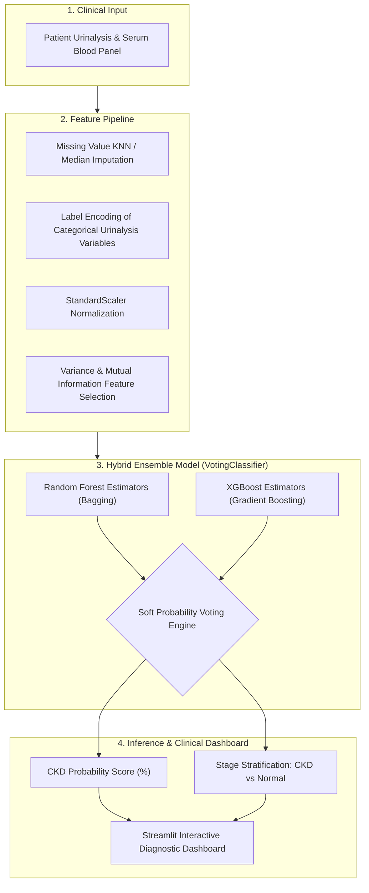

# Chronic Kidney Disease (CKD) Ensemble Risk Prediction

[](https://www.python.org/)
[](https://scikit-learn.org/)
[](https://xgboost.ai/)
[](https://streamlit.io/)
[](https://opensource.org/licenses/MIT)

An ensemble predictive healthcare machine learning system designed to detect and stratify **Chronic Kidney Disease (CKD)** from routine clinical urinalysis and blood biomarker profiles. Built using a soft-voting ensemble of **Random Forest** and **XGBoost (Extreme Gradient Boosting)** classifiers with automated feature selection.

---

## 🏛️ Ensemble Architecture



---

## 🧪 Biomarkers & Selected Clinical Indicators

The model isolates the highest-impact physiological biomarkers from the UCI Machine Learning Chronic Kidney Disease dataset:

| Clinical Feature | Marker | Normal Reference Range | Diagnostic Relevance |
| :--- | :--- | :--- | :--- |
| **Serum Creatinine (`sc`)** | Blood | $0.6 - 1.2 \text{ mg/dL}$ | Primary indicator of glomerular filtration efficiency |
| **Blood Urea (`bu`)** | Blood | $10 - 20 \text{ mg/dL}$ | Clearance of nitrogenous waste products |
| **Hemoglobin (`hemo`)** | Blood | $13.5 - 17.5 \text{ g/dL}$ | Renal erythropoietin deficiency & anemia |
| **Specific Gravity (`sg`)** | Urine | $1.010 - 1.025$ | Urine concentration and tubular reabsorption capacity |
| **Albumin (`al`)** | Urine | $0 \text{ (Negative)}$ | Proteinuria / microalbuminuria glomerular barrier breakdown |
| **Hypertension (`htn`)** | Vitals | Normal ($< 120/80$) | Bidirectional etiology: renal vascular damage |
| **Diabetes Mellitus (`dm`)** | Metabolic | Normal fasting glucose | Leading cause of diabetic nephropathy |

---

## 📂 Repository Structure

```text
kidney-disease-prediction-ml/
└── kidney prediction/
    ├── ckd.csv                 # Cleaned clinical pathology dataset
    ├── ensemble_model.pkl      # Trained VotingClassifier (RandomForest + XGBoost)
    ├── label_encoders.pkl      # Categorical encoders for urinalysis flags
    ├── scaler.pkl              # StandardScaler normalization artifact
    ├── selected_features.pkl   # Serialized optimal feature subset
    ├── model.py                # Streamlit clinical dashboard & inference interface
    └── train.py                # End-to-end training, validation & serialization pipeline
```

---

## 🚀 Execution & Setup

### 1. Installation
```bash
git clone https://github.com/ak-bharadwaj/kidney-disease-prediction-ml.git
cd "kidney-disease-prediction-ml/kidney prediction"

python -m venv venv
source venv/bin/activate  # On Windows: .\venv\Scripts\activate
pip install streamlit pandas numpy scikit-learn xgboost joblib matplotlib
```

### 2. Retraining & Evaluation (Optional)
```bash
python train.py
```
Outputs model accuracy, ROC-AUC curves, and classification metrics.

### 3. Launch Clinical UI
```bash
streamlit run model.py
```
Open [http://localhost:8501](http://localhost:8501) in your browser.
